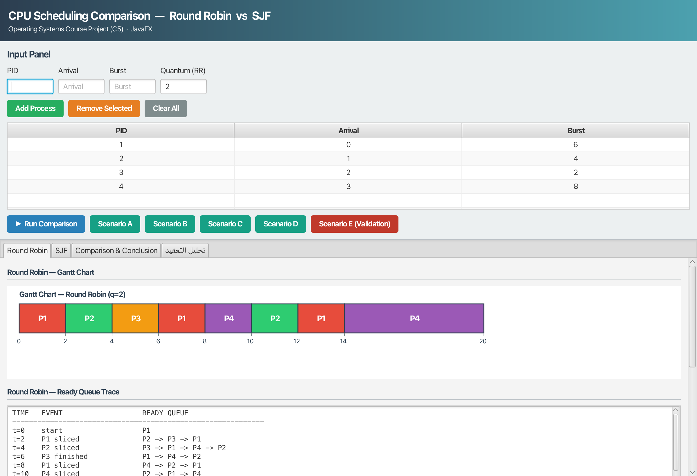
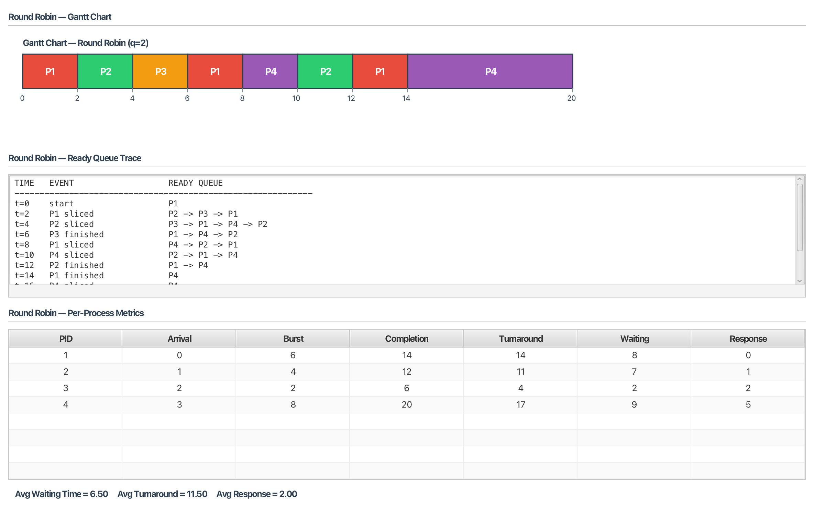
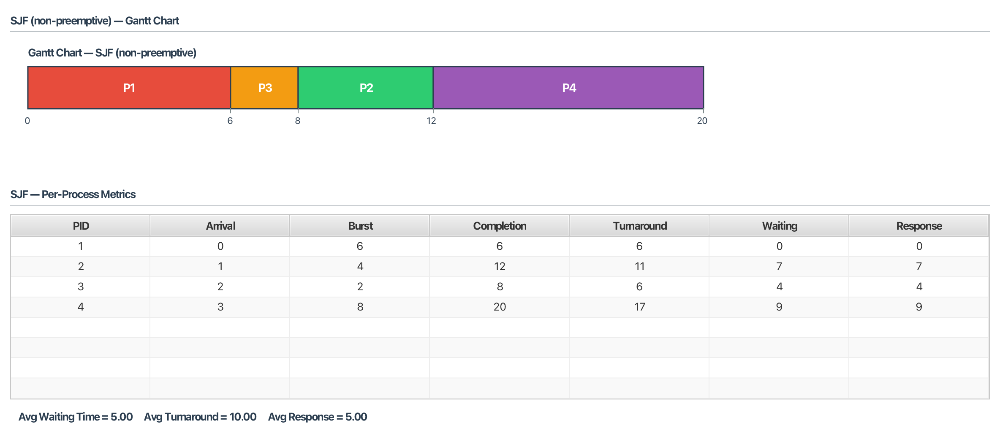
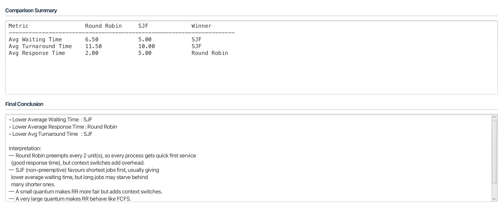

# CPU Scheduling Simulator: Round Robin vs SJF

A JavaFX desktop app that runs the same set of processes through two CPU scheduling algorithms, Round Robin and Shortest Job First, and compares the results side by side. Built for an Operating Systems course.

> The source code is private. This repository shows what the app does and how it's built, with screenshots of it running. There's no live demo because it's a desktop application.

---

## Screenshots

Main window with built-in Scenario A loaded (4 processes, time quantum = 2).



**Round Robin:** Gantt chart, ready-queue trace at every scheduling event, and per-process metrics.



**SJF:** Gantt chart and per-process metrics for the same workload.



**Comparison:** average waiting, turnaround and response times for both algorithms, the better one for each metric, and a written conclusion.



---

## Features

- Add, remove and clear processes (PID, arrival time, burst time) and set the Round Robin time quantum
- Round Robin (preemptive) and SJF (non-preemptive) each run on their own copy of the same workload
- Gantt charts drawn on a JavaFX Canvas, with idle CPU time marked separately
- Round Robin ready-queue trace recorded at every start, time slice, finish and idle period
- Completion, turnaround, waiting and response time for each process, plus averages
- Comparison table with a written conclusion
- Big-O time and space complexity tab (in Arabic), updated for the current input
- Input validation for negative arrival times, non-positive bursts, duplicate PIDs, invalid quantum, and empty or non-numeric fields
- Five built-in test scenarios: basic mix, short-job heavy, fairness, long-job sensitivity, and a validation demo

## Tech stack

Java 17 · JavaFX 21 (Controls, Canvas) · Maven

## Structure

```
gui/          MainUI, InputPanel, GanttChart (Canvas), ResultTable
algorithms/   RoundRobin (preemptive), SJF (non-preemptive)
models/       Process, GanttSegment, QueueSnapshot, SchedulingResult
utils/        Calculator (turnaround, waiting, response times), Validator
```

The GUI validates input, passes a copy of the workload to each algorithm, then renders the returned Gantt segments, queue snapshots and metrics.

## Scheduling rules

- **Round Robin:** FIFO ready queue. A preempted process rejoins the queue after any processes that arrived during its time slice.
- **SJF:** picks the shortest burst among the processes that have arrived. Ties go to the earlier arrival, then the smaller PID.
- **Metrics:** Turnaround = Completion − Arrival; Waiting = Turnaround − Burst; Response = First CPU time − Arrival.

---

## Contact

Marwan Mohsen · [GitHub](https://github.com/marwanmohsen221)
